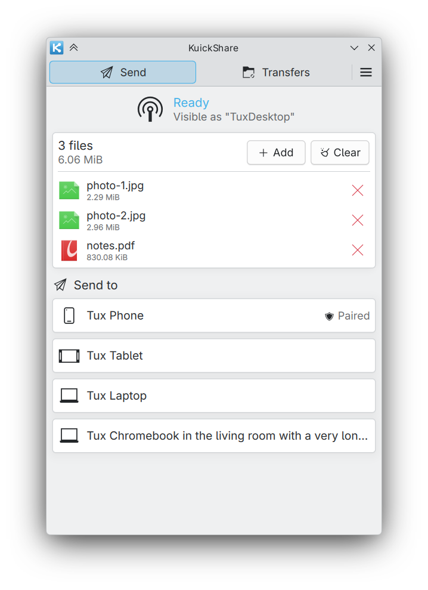
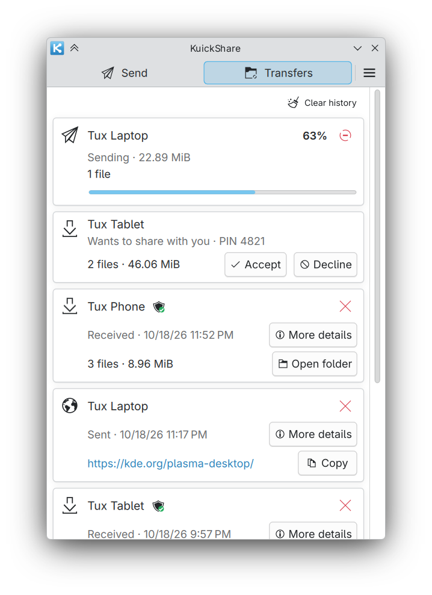

# KuickShare

[](LICENSE)
[](https://github.com/the-beper/KuickShare/actions/workflows/ci.yml)

> [!IMPORTANT]
> KuickShare began as a project for my own personal use, and is shared as is. Generative AI (Claude Code) assisted me in writing the code (almost all of the C++ and QML and a large part of the Rust core) and drafted the documentation and diagrams.

Send files, text and links between your Linux desktop and Android phones with [Quick Share](https://www.android.com/better-together/quick-share/), from a native KDE Plasma 6 app.

<table>
  <tr>
    <td></td>
    <td></td>
  </tr>
</table>

## Why

[Packet](https://github.com/nozwock/packet) is a good Quick Share client, but it is a GTK4 + libadwaita app built for a GNOME environment. KuickShare started from it and keeps its protocol work, with an interface written for Plasma: Breeze look, system tray, Plasma notifications and job progress, and a Dolphin menu entry.

## Why not KDE Connect?

I would love to use KDE Connect, but unfortunately its data transfer feature has been quite unreliable for me. The problems seem to be related to `wpa_supplicant`, but I was not able to triage the issue and switching to `iwd` would cause my Wi-Fi card to simply stop working.

## Features

- Send and receive files, text and links with phones and other Quick Share devices on the same Wi-Fi network.
- Experimental, off by default: send to and receive from a phone that shares no network with the computer, over Bluetooth and a temporary Wi-Fi link (see [Wi-Fi upgrade](docs/wifi-direct.md)).
- Accept or decline incoming transfers from a notification; progress shows in Plasma's job tracker.
- Drag and drop, clipboard paste and **Send with KuickShare** in Dolphin.
- History of past transfers, with automatic cleanup.
- Trusted devices (matched by name and MAC address) and paired KuickShare computers (8-digit code) can send without asking.
- Tray icon, start at login, Do Not Disturb aware.
- English and Italian interface.

> [!NOTE]
> AirDrop cannot be supported. It needs Apple's AWDL Wi-Fi link, which on Linux works only with a few Wi-Fi chips that allow monitor mode and packet injection. Google's AirDrop support in Quick Share on Pixel phones relies on Android-side code and does not change the Quick Share protocol KuickShare speaks. A Wi-Fi link without a shared network is experimental: see [Wi-Fi upgrade](docs/wifi-direct.md).

## Install

Three packages, all for KDE Plasma 6:

| Package | For | How |
|---|---|---|
| Flatpak | Any distribution | Add the repository and install (below); updates arrive through the software center |
| AppImage | Any distribution | Download it from the [releases](https://github.com/the-beper/KuickShare/releases), make it executable and run it. It brings its own libraries and installs nothing; use it with an AppImage manager such as [Gear Lever](https://github.com/mijorus/gearlever), [AM / AppMan](https://github.com/ivan-hc/AM) or [soar](https://github.com/pkgforge/soar) |
| Tarball | Fedora and distributions with Qt 6 and KDE Frameworks 6 | Download `KuickShare-<version>-x86_64.tar.gz`, extract it and run `install.sh`: it installs into `~/.local` and uses the system libraries |

```sh
flatpak remote-add --if-not-exists kuickshare https://the-beper.github.io/KuickShare/kuickshare.flatpakrepo
flatpak install kuickshare io.github.the_beper.KuickShare
```

Or open [kuickshare.flatpakrepo](https://the-beper.github.io/KuickShare/kuickshare.flatpakrepo) with the software center (Discover, GNOME Software). The KDE runtime comes from [Flathub](https://flathub.org/setup), which must be set up.

Update, uninstall and requirements are in the [usage guide](docs/usage.md).

## Documentation

| Document | Content |
|---|---|
| [Usage](docs/usage.md) | Install, update, uninstall, everyday use, trusted and paired devices |
| [Architecture](docs/architecture.md) | Design, security model, packaging |
| [Wi-Fi upgrade](docs/wifi-direct.md) | Transfers without a shared network (experimental): how it works, requirements, limits, open work |
| [D-Bus API](docs/dbus-api.md) | The interface of the background service |
| [Contributing](CONTRIBUTING.md) | Build, tests, translations, releases |
| [Security](SECURITY.md) | Reporting a vulnerability, known limits |
| [Changelog](CHANGELOG.md) | Release notes |

## Credits and license

KuickShare is derived from [Packet](https://github.com/nozwock/packet) and uses [`rqs_lib`](https://github.com/nozwock/rquickshare) for the Quick Share protocol. Dependencies are listed in [THIRD_PARTY.md](THIRD_PARTY.md).

Licensed under [GPL-3.0-or-later](LICENSE).

Quick Share is a Google product. KuickShare is an independent project, not affiliated with or endorsed by Google.
