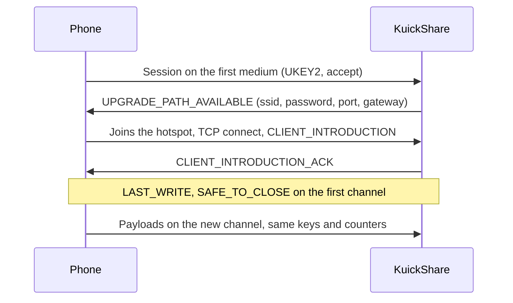

# Wi-Fi upgrade (transfers without a shared network)

> [!WARNING]
> Experimental and off by default (`WifiUpgrade`, Settings → Wi-Fi hotspot). Verified on real hardware (MT7922, Pixel 7 with Wi-Fi off), in both directions, over Bluetooth then Wi-Fi: receiving from the phone (we host a NetworkManager hotspot) and sending to it (the phone hosts a Wi-Fi Direct group that we join as a normal WPA2 client; a 328 MB file arrived intact at about 55 MB/s). Not verified: other phones and Wi-Fi chips, a laptop with its radio in use, the daemon without the manual `setcap` used for receiving (see Open work).

## What it does

Quick Share starts on a cheap medium and can switch to a faster one (the *bandwidth upgrade*). With the setting on, a phone with Wi-Fi off and the computer find each other over Bluetooth Low Energy (BLE), start the transfer there and move it to a Wi-Fi link:

| Direction | Hotspot host | KuickShare does |
|---|---|---|
| Receiving from a phone | KuickShare | Starts an access point with its own DHCP server, offers the credentials, the phone joins and the transfer continues there |
| Sending to a phone | The phone | Scans for the phone, connects over BLE L2CAP, joins the Wi-Fi Direct group (or hotspot) the phone offers as a normal WPA2 client, connects to it and continues there |

If any step fails the transfer stays on the first channel, as it would without the setting.

## Layout

| Part | Where |
|---|---|
| Protocol: frames, hand-over state machine, timeouts, `WifiLink` trait | `third_party/rqs_lib/src/upgrade.rs`, handlers in `hdl/inbound.rs` and `hdl/outbound.rs` (see [THIRD_PARTY.md](../THIRD_PARTY.md)) |
| BLE receiver: `0xFEF3` advertisement, GATT "weave" service, bridge to a normal receive session | `third_party/rqs_lib/src/hdl/ble_receiver/` |
| BLE sender: windowed scan, L2CAP dial, central bridge | `third_party/rqs_lib/src/hdl/ble_scan.rs`, `hdl/ble_send/` |
| Bluetooth devices in the app: `ble:` ids, `ScanBluetooth`, "Connecting…" job, Send page cleanup | `src/core/app.rs`, `src/core/dbus.rs`, `src/shell/` (see [D-Bus API](dbus-api.md)) |
| NetworkManager backend (`NmLink`): hotspot and join over D-Bus | `src/core/link.rs` |
| DHCP server for the hotspot | `src/core/dhcp.rs` |
| Setting | `wifi_upgrade` in `settings.json`, D-Bus property `WifiUpgrade` |

## Requirements and limits

| Item | Detail |
|---|---|
| Network stack | NetworkManager with a Wi-Fi card that can run an access point |
| Medium | Receiving: `WIFI_HOTSPOT` (we host). Sending: `WIFI_DIRECT` or `WIFI_HOTSPOT` as the phone offers (it hosts, we join). A P2P group on our side is not used, see [below](#why-not-a-p2p-group) |
| Privileges | Sending: none. Receiving: binding the DHCP port (67) needs `CAP_NET_BIND_SERVICE` and `CAP_NET_RAW`, or root, so a normal user cannot receive yet. The planned design is a small root helper (systemd unit plus a polkit rule for the active local user, password only at install), chosen because it fits Flatpak, AppImage and tarball |
| Firewall | The hotspot connection is put in the `trusted` firewalld zone. A rule for the single needed port is still to do |
| Wi-Fi on the host | With one radio the normal Wi-Fi connection may drop while the hotspot is up; the previous connection is re-activated when the transfer ends normally, but not after a crash (NetworkManager then reconnects by itself). With the setting on, the daemon deletes every NetworkManager profile whose name starts with `kuickshare-` at start and stop |
| Discovery | Over the LAN as usual. For a phone that is not on it, the BLE receiver advertises the computer while the setting is on and the device is visible. This makes the computer, under its device name, visible over Bluetooth to anything in range. It sends no data without the user's consent |
| BLE speed | About 5 KB/s, so a transfer over BLE is only useful if the hotspot upgrade succeeds. A phone on the same LAN refuses a hotspot upgrade (Nearby's own rule), so the upgrade only applies off-LAN |
| Sending | To a phone in Receive mode (visibility Everyone), found by a short BLE scan (the Send page and its refresh button). Needs no privileges: the phone hosts the network and we join it through NetworkManager. The sender announces `WIFI_HOTSPOT` and `WIFI_DIRECT`; the Pixel offered `WIFI_DIRECT` by itself. After the upgrade the phone uses frames without encryption (`supports_disabling_encryption`), which we follow. The sender holds the files for up to 10 s waiting for the offer |
| Flatpak | The manifest grants `--system-talk-name=org.freedesktop.NetworkManager`. Binding the DHCP port and `ip neigh` inside the sandbox are **unresolved**, so the feature will not work there until the privilege design exists |

## Why not a P2P group

Creating a real Wi-Fi Direct group owner through wpa_supplicant's D-Bus works at the driver level, but NetworkManager 1.56 adopts the new `p2p-<if>-N` supplicant interface and removes it about 80 ms later. Marking the interface or `p2p-dev-<if>` unmanaged did not prevent it. Reading `Group.SSID` on a destroyed group also crashes wpa_supplicant 2.11. The hotspot path avoids both.

Findings from the hand test (tested Wi-Fi chip: MT7922, tested phone: Pixel 7):

- A NetworkManager AP-mode hotspot is visible to the phone and accepts WPA2.
- Broadcast DHCP offers were never accepted by the phone; unicast replies to the client's MAC (with a static neighbour entry) worked. `dhcp.rs` therefore answers by unicast unless the client asks for broadcast.
- Android drops a network it validated as having no internet when joined from Settings. Nearby joins programmatically, which is expected to avoid this *(unverified)*.

## Not verified yet

- Why the first connection after a daemon start used to fail (see Open work 3).
- Phones other than a Pixel 7 and Wi-Fi chips other than the MT7922; a laptop that is using its radio.
- That Plasma updates the title and the cancel button of the "Connecting…" job when the transfer starts (the shell changes the job's description and capabilities; the tracker's behaviour was not checked).
- The advertisement leaves out the opaque "RxInstantConnectionAdv" field seen in another project's capture; the phone listed the computer without it.
- That the phone's `CLIENT_INTRODUCTION` endpoint id matches the one in its connection request (the receiver requires it).
- The plain frames after the upgrade follow what the phone's log shows (it discards our encrypted frames and sends plain ones); the writing side of the reference code was not read.

## Testing

`cargo test -p rqs_lib` runs the hand-over, plain and encrypted, the Bluetooth receiver and sender and the scanner in memory and over loopback with a fake `WifiLink`. `cargo test --all-features` covers `link.rs` with a fake NetworkManager. Neither needs hardware. The real link needs a manual test (Wi-Fi card, Bluetooth adapter, phone, `adb logcat` and `btmon` captures): the procedure is in [CONTRIBUTING.md](../CONTRIBUTING.md#hand-tests-with-a-phone-wi-fi-upgrade-and-bluetooth).

## Open work

Order is the planned one; the first item is next.

| # | Work | Notes |
|---|---|---|
| 1 | **BLE send: follow-ups** | Sending works (see Requirements and limits). Still open: other phones (Samsung) and chips; `UPGRADE_PATH_REQUEST` for receivers that never offer an upgrade by themselves (the Pixel does); the GATT/weave fallback for phones that do not advertise an L2CAP PSM; the 25 s watchdog that reports a send that never started is a guess; the join to the phone's network took 3 to 8 s in the runs (the phone gives up after about 15 s); while scanning, dialling and joining the user only sees a "Connecting…" job, with no detail; the D-Bus `medium` and `ble:` ids are covered by tests only without Bluetooth |
| 2 | **Privilege helper** | Small root helper (systemd unit + polkit rule for the active local user: password only at install) that owns port 67 and `ip neigh`. Chosen because it fits Flatpak (helper installed on the host), AppImage and tarball. Also: replace the `trusted` firewalld zone with a rule for the needed ports, unicast DHCP replies (needs `CAP_NET_ADMIN`), gate the Settings switch until the helper is present |
| 3 | First connection after a daemon start | It failed in three different ways on the first connection after a start (a keep-alive while waiting for the `ConnectionResponse`, an early `Response` frame, an unexpected frame). The keep-alive case is handled and the next run passed, with a pause of about 6 s between the PIN and the consent. Confirm with the `debug` log of `rqs_lib::hdl::inbound`, and find out what the early `Response` frame was (the error now prints its status) |
| 4 | Verify on hardware | Samsung and other phones; other Wi-Fi chips and single-radio laptops while connected to Wi-Fi (the radio is shared with the hotspot); DFS and regulatory domains (channel 36 with fallback to 2.4 GHz); the MT7922 Bluetooth controller reset by itself once during a scan (`LE Set Extended Scan Enable` timeout, USB reset, firmware reload; the cause is unknown); two phones at once; BLE re-advertising and `Device::disconnect` side effects; GATT notify race (a rewrite with `CharacteristicNotifyMethod::Io` would bind the session to the subscriber); the discovery of phones on the LAN after the removal of the BLE scanner |
| 5 | Tests still missing | Keep-alive cap and the disconnect race at handler level (needs a scripted peer and a fake adapter); a real NetworkManager run of `link.rs` |
| 6 | Upstream bug | `rqs_lib` mis-encodes public keys with a leading zero byte (about 1 handshake in 70 fails); fix it in the fork |

Phone checklist for item 1: `adb logcat -s NearbyConnections NearbyMediums NearbySharing WifiP2pService` (the phone's decisions are in its log: offered medium, `supports_disabling_encryption`, join latency, invalid frames) together with the daemon log and `btmon -w`; repeat with a phone on another network and on the same LAN (a phone on the same LAN refuses a hotspot upgrade).

## Documentation still to write or fix

| File | Missing or stale |
|---|---|
| `THIRD_PARTY.md` | The Rust crate list is generated and stale (`btleplug` removed; `socket2`, `rand`, `futures-util` added) |
| Packaging | `build/flatpak/cargo-sources.json` must be regenerated before any Flatpak build; the installers need the helper once it exists |
| Translations | The new Settings and Send page strings are not yet in the translation templates |
| `HelpPage.qml` | The trust text should say it does not apply to Bluetooth transfers |
| `docs/architecture.md` | The data-flow section does not describe the Bluetooth path yet |

## References

| Project | Use here |
|---|---|
| [google/nearby](https://github.com/google/nearby) | Reference for frame order, timeouts and credentials (`bwu_manager.cc`) |
| [quickshare-direct](https://github.com/papshmeare/quickshare-direct) | Linux implementation of both directions, tested on a Pixel; source of the timing notes |
| [open-quickshare](https://github.com/ignotusbucius/open-quickshare) | Same idea over `nmcli`; client join and role switch |
| [Bada #256](https://github.com/kyujin-cho/Bada/issues/256) | For a send that starts on a slow medium the sender may have to request the upgrade itself *(not implemented)* |
