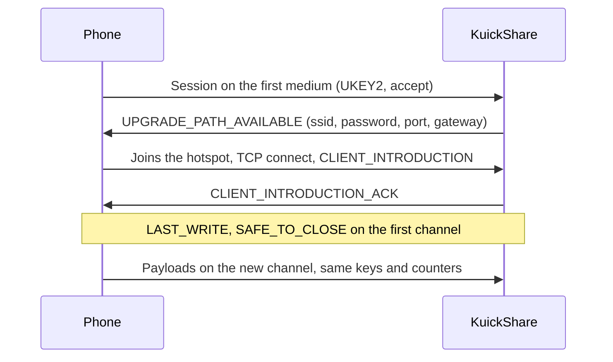

# Wi-Fi upgrade (transfers without a shared network)

> [!WARNING]
> Experimental and off by default (`WifiUpgrade`, Settings → Wi-Fi hotspot). Verified on real hardware (MT7922, Pixel 7 with Wi-Fi off), in both directions, over Bluetooth then Wi-Fi: receiving from the phone (we host a NetworkManager hotspot) and sending to it (the phone hosts a Wi-Fi Direct group that we join as a normal WPA2 client; a 328 MB file arrived intact at about 55 MB/s). Not verified: other phones and Wi-Fi chips, a laptop with its radio in use, Flatpak.

## What it does

Quick Share starts on a cheap medium and can switch to a faster one (the *bandwidth upgrade*). With the setting on, a phone with Wi-Fi off and the computer find each other over Bluetooth Low Energy (BLE), start the transfer there and move it to a Wi-Fi link:

| Direction | Hotspot host | KuickShare does |
|---|---|---|
| Receiving from a phone | KuickShare | Starts an access point (NetworkManager serves DHCP), offers the credentials, the phone joins and the transfer continues there |
| Sending to a phone | The phone | Scans for the phone, connects over BLE L2CAP, joins the Wi-Fi Direct group (or hotspot) the phone offers as a normal WPA2 client, connects to it and continues there |

If any step fails the transfer stays on the first channel, as it would without the setting.

## Layout

| Part | Where |
|---|---|
| Protocol: frames, hand-over state machine, timeouts, `WifiLink` trait | `third_party/rqs_lib/src/upgrade.rs`, handlers in `hdl/inbound.rs` and `hdl/outbound.rs` (see [THIRD_PARTY.md](../THIRD_PARTY.md)) |
| BLE receiver: `0xFEF3` advertisement, GATT "weave" service, bridge to a normal receive session | `third_party/rqs_lib/src/hdl/ble_receiver/` |
| BLE sender: windowed scan, L2CAP dial, central bridge | `third_party/rqs_lib/src/hdl/ble_scan.rs`, `hdl/ble_send/` |
| Bluetooth devices in the app: `ble:` ids, `ScanBluetooth`, job with its steps, Send page cleanup | `src/core/app.rs`, `src/core/dbus.rs`, `src/shell/` (see [D-Bus API](dbus-api.md)) |
| NetworkManager backend (`NmLink`): hotspot and join over D-Bus | `src/core/link.rs` |
| Setting | `wifi_upgrade` in `settings.json`, D-Bus property `WifiUpgrade` |

## Requirements and limits

| Item | Detail |
|---|---|
| Network stack | NetworkManager with a Wi-Fi card that can run an access point |
| Medium | Receiving: `WIFI_HOTSPOT` (we host). Sending: `WIFI_DIRECT` or `WIFI_HOTSPOT` as the phone offers (it hosts, we join). A P2P group on our side is not used, see [below](#why-not-a-p2p-group) |
| Privileges | None. The hotspot profile uses the `shared` IPv4 method, so NetworkManager starts its own `dnsmasq` for DHCP; the `dnsmasq` package must be installed on the host (without it the hotspot fails to start; the log then names it as a possible cause) |
| Firewall | While the hotspot is up, the upgrade port (TCP, random per transfer) is opened in firewalld's `nm-shared` zone through its D-Bus API and closed when the transfer ends (it also expires after 300 s). The hotspot profile is put in that zone, which otherwise allows only DHCP, DNS, ssh and ICMP. If firewalld cannot be changed (not running, or polkit refuses `org.fedoraproject.FirewallD1.zone`: Fedora allows `wheel` users, other distributions ask for a password) the profile goes to the `trusted` zone instead and the log says so, which lets the phone reach every service of the computer. Other firewalls (ufw, plain nftables) are not handled: they cannot be changed without root, so with them the zone is always `trusted`. Turning the setting on when firewalld is not running asks for confirmation first (`FirewallManaged` over D-Bus; *not tested* with ufw or nftables, nor inside Flatpak or the AppImage, where the check relies on the permission to talk to firewalld's name) |
| Wi-Fi on the host | With one radio the normal Wi-Fi connection may drop while the hotspot is up; the previous connection is re-activated when the transfer ends normally, but not after a crash (NetworkManager then reconnects by itself). With the setting on, the daemon deletes every NetworkManager profile whose name starts with `kuickshare-` at start and stop |
| Discovery | Over the LAN as usual. For a phone that is not on it, the BLE receiver advertises the computer while the setting is on and the device is visible. This makes the computer, under its device name, visible over Bluetooth to anything in range. It sends no data without the user's consent |
| Network loss | When NetworkManager reports that the last connection is gone, the devices found over the LAN are dropped at once (otherwise they stay until their mDNS records expire) and one Bluetooth scan runs. With another connection still up (Ethernet) nothing happens. When a network comes back, the discovery is restarted (the list is kept), because the mDNS library only checks for new interfaces every 30 s. Both are *not tested with a phone*; the Wi-Fi that KuickShare itself brings up for a receive also triggers the restart, which is harmless |
| LAN sessions | A transfer over the LAN never takes part in the upgrade: the sender announces `WIFI_LAN` as it did before the feature, and a receiver does not host a hotspot for a LAN peer. Only Bluetooth sessions upgrade. A phone seen both on the LAN and over Bluetooth is listed once, on the LAN |
| BLE speed | About 5 KB/s, so a transfer over BLE is only useful if the hotspot upgrade succeeds. A phone on the same LAN refuses a hotspot upgrade (Nearby's own rule), so the upgrade only applies off-LAN |
| Sending | To a phone in Receive mode (visibility Everyone) **that advertises an L2CAP PSM**, found by a short BLE scan (the Send page and its refresh button). A phone that advertises only GATT is listed but cannot be sent to yet (see Open work 0 and the plan below). The phone hosts the network and we join it through NetworkManager. The sender announces `WIFI_HOTSPOT` and `WIFI_DIRECT`; the Pixel offered `WIFI_DIRECT` by itself. After the upgrade the phone uses frames without encryption (`supports_disabling_encryption`), which we follow. The sender holds the files for up to 10 s waiting for the offer |
| Trusted devices | Not available over Bluetooth: trust is keyed on the sender's MAC address read from its IP, which a BLE session does not have, and the phone's MAC on the Wi-Fi link is not the LAN one *(inferred)*. Every Bluetooth transfer asks for consent; the trust button is hidden and pairing is refused |
| Flatpak | The manifest grants `--system-talk-name=org.freedesktop.NetworkManager` and `--system-talk-name=org.fedoraproject.FirewallD1`, and NetworkManager does the privileged work on the host, so only `dnsmasq` on the host is needed. Sending over Bluetooth also needs `--allow=bluetooth` (the L2CAP socket). Receiving from a phone was verified in the sandbox. A send started a few seconds after the list was filled once stayed at "Looking for the device…" (the rescan found nothing); the suspected cause is a rescan that started before BlueZ had stopped the previous discovery, now waited for in `ble_scan.rs` *(unverified)* |
| Bluetooth controller | The MT7922 used for testing has known weird behaviours. It reset itself once during a scan (`LE Set Extended Scan Enable` timeout, USB reset, firmware reload); the next attempt worked, and the cause was not investigated |
| Tests | The `medium` key, the `ble:` ids and the watchdog that reports a send that never started are tested without an adapter. A send through a real adapter has no automated test (it would need a fake BlueZ inside `rqs_lib`): only the `#[ignore]` hardware tests, run by hand, cover it |

## Why not a P2P group

Creating a real Wi-Fi Direct group owner through wpa_supplicant's D-Bus works at the driver level, but NetworkManager 1.56 adopts the new `p2p-<if>-N` supplicant interface and removes it about 80 ms later. Marking the interface or `p2p-dev-<if>` unmanaged did not prevent it. Reading `Group.SSID` on a destroyed group also crashes wpa_supplicant 2.11. The hotspot path avoids both.

Findings from the hand test (tested Wi-Fi chip: MT7922, tested phone: Pixel 7):

- A NetworkManager AP-mode hotspot is visible to the phone and accepts WPA2.
- A DHCP server of our own had to answer by unicast to the client's MAC: the phone never accepted broadcast offers. NetworkManager's `dnsmasq` (`ipv4.method=shared`) works with the Pixel in both directions, so our server was removed.
- Android drops a network it validated as having no internet when joined from Settings. Nearby joins programmatically, which is expected to avoid this *(unverified)*.

## Not verified yet

- The NAT rules that NetworkManager adds for the shared connection were not checked.
- Phones other than a Pixel 7 and Wi-Fi chips other than the MT7922; a laptop that is using its radio.
- That Plasma shows each new step text and the cancel button of the transfer job as the shell changes them (it emits the job's description and capabilities; the tracker's behaviour was not checked).
- The advertisement leaves out the opaque "RxInstantConnectionAdv" field seen in another project's capture; the phone listed the computer without it.
- That the phone's `CLIENT_INTRODUCTION` endpoint id matches the one in its connection request (the receiver requires it).
- The plain frames after the upgrade follow what the phone's log shows (it discards our encrypted frames and sends plain ones); the writing side of the reference code was not read.

## Testing

`cargo test -p rqs_lib` runs the hand-over, plain and encrypted, the Bluetooth receiver and sender and the scanner in memory and over loopback with a fake `WifiLink`. `cargo test --all-features` covers `link.rs` with a fake NetworkManager. Neither needs hardware. The real link needs a manual test (Wi-Fi card, Bluetooth adapter, phone, `adb logcat` and `btmon` captures): the procedure is in [CONTRIBUTING.md](../CONTRIBUTING.md#hand-tests-with-a-phone-wi-fi-upgrade-and-bluetooth).

## Open work

Every item needs a device or a setup that was not available so far. Item 0 is a regression seen on the only test phone and comes first.

| # | Work | Notes |
|---|---|---|
| 0 | **Verify first: the Pixel no longer offers an L2CAP channel** | Sending worked on the Pixel 7 (Android 17) over L2CAP, then stopped: the scan sees the phone, but its full advertisement has no PSM (mask `0x02`, bit `0x01` clear) and `logcat` shows `allowBleL2capConnections=false`, `allowGattConnections=true`, in both Receive modes (BACKGROUND and MIDGROUND). Restarting the phone's Bluetooth and reopening the Receive screen changed nothing, and nothing was changed on the phone. The cause is unknown. To do: (1) keep a `logcat` and a `btmon` capture of every run (`dist/test-wifi.sh`) so a working and a failing run can be compared; (2) check the phone's Google Play services and Quick Share versions and whether they updated between the working and the failing run (the sending test that worked was a few hours earlier on the same day); (3) look for a Quick Share setting or a phone state that sets the flag; (4) try another phone to see whether it is the Pixel or the protocol. Result decides how urgent item 1 is |
| 1 | GATT client for phones without L2CAP | Plan below. Needed whenever item 0 is not a transient state of the phone |
| 2 | Receivers that do not offer an upgrade | The Pixel offers one by itself. Send `UPGRADE_PATH_REQUEST` for receivers that do not; needs such a phone to be verified |
| 3 | Other hardware | Samsung and other phones; other Wi-Fi chips; single-radio laptops while connected to Wi-Fi (the radio is shared with the hotspot); DFS and regulatory domains (channel 36 with fallback to 2.4 GHz); two phones at once |
| 4 | Unexplained behaviour | The 25 s watchdog that reports a Bluetooth send that never started is a guess; the join to the phone's network takes up to about 9 s and the phone gives up after about 15 s; BLE re-advertising and `Device::disconnect` side effects; the GATT notify race (a rewrite with `CharacteristicNotifyMethod::Io` would bind the session to the subscriber); phones on the LAN were not rechecked after the BLE scanner was removed; a phone that cancels in the middle of a file is noticed only when a write makes no progress for 30 s (the user's own cancel works at once; a cancel frame sent by the phone is not read while we send); the Pixel sends its full advertisement only about every 10 s, so a scan window shorter than that can miss it (the window is now 15 s) |
| 5 | Other firewalls and distributions | Only firewalld on Fedora was tried. With ufw or nftables the hotspot always uses the `trusted` zone, which opens every port to the phone, and their own rules may also block DHCP and DNS of the hotspot *(not tested)*. The case where polkit refuses the change on firewalld has not been tried |

Phone checklist for items 0 to 4: `adb logcat -s NearbyConnections NearbyMediums NearbySharing WifiP2pService` (the phone's decisions are in its log: offered medium, `supports_disabling_encryption`, join latency, invalid frames, `allowBleL2capConnections`) together with the daemon log and `btmon -w`. Repeat with a phone on another network and on the same LAN (a phone on the same LAN refuses a hotspot upgrade).

## Plan: GATT client for phones without L2CAP

**Goal.** Send to a phone that advertises `allowGattConnections=true` but no PSM, by acting as the GATT central of the Nearby "BLE socket" and running the same send session as over L2CAP. The transfer then moves to Wi-Fi as before; GATT only carries the first handshake and the upgrade offer, so its low speed (a few KB/s) does not matter.

**What exists and what is missing**

| Piece | State |
|---|---|
| Weave framing (packet header, fragmentation, reassembly, `CONNECTION_REQUEST`/`CONFIRM` parsing and building), socket messages (introduction, data with the service id hash), `WeaveSession` | Written for the receiver role in `hdl/ble_receiver/` (`weave.rs`, `socket.rs`, `session.rs`) and tested. The central role needs the mirror image: send the request, parse the confirm |
| Send session over a duplex stream (`send_over_l2cap`, `CentralBridge`) | Exists in `hdl/ble_send/` and is independent of the transport |
| GATT characteristic UUIDs (slot 0, write to the peripheral, notify from the peripheral) | In `ble_receiver/gatt.rs`, taken from the references. **Not checked against the Pixel's own GATT table** |
| Scan result without a PSM | Listed, but not usable; the error now says so |
| GATT client with BlueZ (connect, discover, MTU, write, notify) | **Missing** (bluer's `gatt::remote` API) |

**Steps**

| # | Step | Done when | Needs the phone |
|---|---|---|---|
| 0 | Dump the Pixel's GATT table: connect from the PC (`bluetoothctl`, `menu gatt`, `list-attributes`) while it is in Receive mode, with a `btmon` capture | UUIDs and properties of the service and its characteristics are known and match `gatt.rs` | yes |
| 1 | Central side of weave: build `CONNECTION_REQUEST` (version, packet size), parse `CONNECTION_CONFIRM`, negotiate the packet size from the MTU | Unit tests; a loopback test against the receiver's own `BleBridge` as the peer | no |
| 2 | `GattCentralBridge`: the same shape as `CentralBridge`, with weave packets instead of L2CAP SDUs, presented to `OutboundRequest` as a duplex stream | Loopback test: a whole send session against the receiver bridge, in memory | no |
| 3 | GATT dial with bluer: connect, wait for service resolution, find the characteristics, subscribe to notifications, write with the negotiated size, stop the scan before connecting and drop a stale connection first (as `dial_l2cap` does) | Compiles and passes clippy; behaviour checked in step 5 | no |
| 4 | Wiring: the scan result carries the transport (L2CAP with PSM, otherwise GATT when the advertisement says it is connectable); `send` picks it; errors and docs updated | Unit tests of the choice | no |
| 5 | Hardware: a small file to the Pixel over GATT, then the upgrade to Wi-Fi Direct and a large file | The same checks as the L2CAP runs: transfer complete, speed, no stuck state | yes |

**Risks and unknowns**

- The Pixel's GATT table and its behaviour toward a non-Google central are unverified; step 0 comes first because it can end the plan early.
- Whether the phone needs a bonded or encrypted link for GATT, and how it reacts to our MTU request.
- Timeouts of the weave handshake on the phone side (the receiver side uses 10 s and 30 s).
- The same BlueZ discovery race seen before: stop the scan and wait for it before connecting.
- Flatpak: BlueZ is reached over D-Bus, which the manifest allows; no raw socket is needed for GATT.

**Tests without hardware.** Steps 1 and 2 give a full in-memory send over the GATT-style transport, with our receiver as the peer, so most of the code is covered before the first run with the phone.

## References

| Project | Use here |
|---|---|
| [google/nearby](https://github.com/google/nearby) | Reference for frame order, timeouts and credentials (`bwu_manager.cc`) |
| [quickshare-direct](https://github.com/papshmeare/quickshare-direct) | Linux implementation of both directions, tested on a Pixel; source of the timing notes |
| [open-quickshare](https://github.com/ignotusbucius/open-quickshare) | Same idea over `nmcli`; client join and role switch |
| [Bada #256](https://github.com/kyujin-cho/Bada/issues/256) | For a send that starts on a slow medium the sender may have to request the upgrade itself *(not implemented)* |
