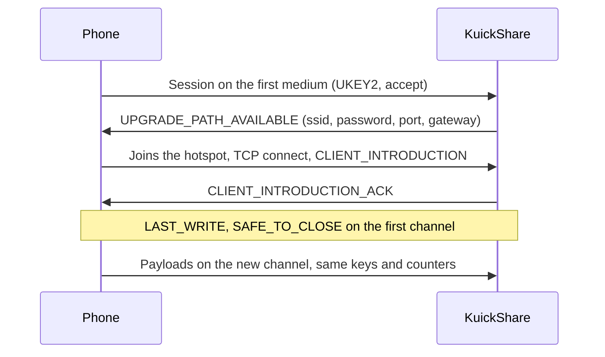

# Wi-Fi upgrade (transfers without a shared network)

> [!WARNING]
> Experimental and off by default (`WifiUpgrade`, Settings → Wi-Fi hotspot). One run on real hardware (MT7922, Pixel 7 with Wi-Fi off, receiving a file) shows, from a Bluetooth capture and the NetworkManager log: the phone lists the computer over BLE, connects, completes the weave and UKEY2 exchange; NetworkManager starts the hotspot over D-Bus without a prompt; the file arrives at hotspot speed and the hotspot is removed afterwards. The first attempt of that run failed before the hotspot was started, for a reason not yet known. Sending to a phone, Samsung phones, other chips and the daemon log of the successful hand-over have not been checked.

## What it does

Quick Share starts on a cheap medium and can switch to a faster one (the *bandwidth upgrade*). With the setting on, KuickShare handles the `WIFI_HOTSPOT` medium in both directions, and a phone with Wi-Fi off can reach the computer over Bluetooth Low Energy (BLE) first:

| Direction | Hotspot host | KuickShare does |
|---|---|---|
| Receiving from a phone | KuickShare | Starts an access point with its own DHCP server, offers the credentials, the phone joins and the transfer continues there |
| Sending to a phone | The phone | Joins the network the phone offers, connects to it and continues there |

If any step fails the transfer stays on the first channel, as it would without the setting.

## Layout

| Part | Where |
|---|---|
| Protocol: frames, hand-over state machine, timeouts, `WifiLink` trait | `third_party/rqs_lib/src/upgrade.rs`, handlers in `hdl/inbound.rs` and `hdl/outbound.rs` (see [THIRD_PARTY.md](../THIRD_PARTY.md)) |
| BLE receiver: `0xFEF3` advertisement, GATT "weave" service, bridge to a normal receive session | `third_party/rqs_lib/src/hdl/ble_receiver/` |
| NetworkManager backend (`NmLink`): hotspot and join over D-Bus | `src/core/link.rs` |
| DHCP server for the hotspot | `src/core/dhcp.rs` |
| Setting | `wifi_upgrade` in `settings.json`, D-Bus property `WifiUpgrade` |

## Requirements and limits

| Item | Detail |
|---|---|
| Network stack | NetworkManager with a Wi-Fi card that can run an access point |
| Medium | `WIFI_HOTSPOT` only. `WIFI_DIRECT` (a real P2P group) is not used, see [below](#why-not-a-p2p-group) |
| Privileges | None for the hotspot itself. Binding the DHCP port (67) needs `CAP_NET_BIND_SERVICE` and `CAP_NET_RAW`, or root, so the privilege design is **not done** and the feature cannot run as a normal user yet |
| Firewall | The hotspot connection is put in the `trusted` firewalld zone. A rule for the single needed port is still to do |
| Wi-Fi on the host | With one radio the normal Wi-Fi connection may drop while the hotspot is up; the previous connection is re-activated when the transfer ends normally, but not after a crash (NetworkManager then reconnects by itself). With the setting on, the daemon deletes every NetworkManager profile whose name starts with `kuickshare-` at start and stop |
| Discovery | Over the LAN as usual. For a phone that is not on it, the BLE receiver advertises the computer while the setting is on and the device is visible. This makes the computer, under its device name, visible over Bluetooth to anything in range. It sends no data without the user's consent, but it is **untested with a phone** |
| BLE speed | About 5 KB/s, so a transfer over BLE is only useful if the hotspot upgrade succeeds. A phone on the same LAN refuses a hotspot upgrade (Nearby's own rule), so the upgrade only applies off-LAN |
| Sending | Only over the LAN or the hotspot path: sending to a phone over BLE is not implemented. The phone must offer a hotspot after it accepts; the sender holds the files for up to 10 s waiting for the offer |
| Flatpak | The manifest grants `--system-talk-name=org.freedesktop.NetworkManager`. Binding the DHCP port and `ip neigh` inside the sandbox are **unresolved**, so the feature will not work there until the privilege design exists |

## Why not a P2P group

Creating a real Wi-Fi Direct group owner through wpa_supplicant's D-Bus works at the driver level, but NetworkManager 1.56 adopts the new `p2p-<if>-N` supplicant interface and removes it about 80 ms later. Marking the interface or `p2p-dev-<if>` unmanaged did not prevent it. Reading `Group.SSID` on a destroyed group also crashes wpa_supplicant 2.11. The hotspot path avoids both.

Findings from the hand test (tested Wi-Fi chip: MT7922, tested phone: Pixel 7):

- A NetworkManager AP-mode hotspot is visible to the phone and accepts WPA2.
- Broadcast DHCP offers were never accepted by the phone; unicast replies to the client's MAC (with a static neighbour entry) worked. `dhcp.rs` therefore answers by unicast unless the client asks for broadcast.
- Android drops a network it validated as having no internet when joined from Settings. Nearby joins programmatically, which is expected to avoid this *(unverified)*.

## Not verified yet

- Why the first attempt of the hardware run failed (consent timeout, the known upstream UKEY2 key-encoding bug, or a BLE problem), and how often it happens.
- The hand-over against a phone in the sending direction.
- The advertisement leaves out the opaque "RxInstantConnectionAdv" field seen in another project's capture; the phone listed the computer without it.
- That the phone's `CLIENT_INTRODUCTION` endpoint id matches the one in its connection request (the receiver requires it).
- Behaviour on Samsung phones and other Wi-Fi chips.

## Testing

`cargo test -p rqs_lib` runs the hand-over over loopback with a fake `WifiLink`. `cargo test --all-features` covers `link.rs` with a fake NetworkManager. Neither needs Wi-Fi hardware; the real link needs a manual test (Wi-Fi card, phone, firewall zone), as in the matrix chip × phone × direction.

## Open work

Order is the planned one; the first item is next.

| # | Work | Notes |
|---|---|---|
| 1 | **Send to a phone over BLE** | We are the BLE central; the phone hosts the hotspot or a Wi-Fi Direct group and we join it as a normal WPA2 client over NetworkManager (no root). Steps: (a) L2CAP CoC framing and a production central bridge, tested against our own BLE receiver in memory; (b) windowed BLE scan (8-10 s at Send page open and refresh, never continuous: it disturbs bonded LE devices, rquickshare #429); (c) dial and send a small file; (d) join the phone's network, accepting `WIFI_DIRECT` credentials as well as `WIFI_HOTSPOT`, and send `medium_metadata` (5 GHz); (e) wiring: `EndpointInfo`/`SendInfo` with a BLE branch, device id `ble:<endpoint_id>`, D-Bus `medium` key, GUI label "Bluetooth", no trust for BLE; (f) GATT/weave fallback only if L2CAP is not enough. Needs `adb logcat` and `btmon` captures to settle the unknowns (see the phone checklist below) |
| 2 | **Privilege helper** | Small root helper (systemd unit + polkit rule for the active local user: password only at install) that owns port 67 and `ip neigh`. Chosen because it fits Flatpak (helper installed on the host), AppImage and tarball. Also: replace the `trusted` firewalld zone with a rule for the needed ports, unicast DHCP replies (needs `CAP_NET_ADMIN`), gate the Settings switch until the helper is present |
| 3 | First connection after a daemon start | It failed in four different ways before the keep-alive fix (unexpected frame, early `Response`, keep-alive) and worked once after it. Confirm with the `debug` log of `rqs_lib::hdl::inbound` and find out what the early `Response` frame was (the error now prints its status) |
| 4 | Verify on hardware | Samsung and other phones; other Wi-Fi chips and single-radio laptops while connected to Wi-Fi (the radio is shared with the hotspot); DFS and regulatory domains (channel 36 with fallback to 2.4 GHz); two phones at once; BLE re-advertising and `Device::disconnect` side effects; GATT notify race (a rewrite with `CharacteristicNotifyMethod::Io` would bind the session to the subscriber); the discovery of phones on the LAN after the removal of the BLE scanner |
| 5 | Tests still missing | Keep-alive cap and the disconnect race at handler level (needs a scripted peer and a fake adapter); a real NetworkManager run of `link.rs` |
| 6 | Upstream bug | `rqs_lib` mis-encodes public keys with a leading zero byte (about 1 handshake in 70 fails); fix it in the fork |
| 7 | Plasma notifications | plasma-nm shows "Connection 'kuickshare-ap' activated/deactivated" for every transfer; it has no per-connection filter, only the global event switches in System Settings → Notifications → Network Management |

Phone checklist for item 1: `btmon -w` during the scan and during the L2CAP connection (PSM, whether pairing is requested); `adb logcat -s NearbyConnections NearbyMediums NearbySharing` for the mediums of the connection request, the offered upgrade medium and hotspot start errors with Wi-Fi off; the matrix mediums `[hotspot]` and `[hotspot, direct]` × phone Wi-Fi off, on another network, on the same LAN.

## Documentation still to write or fix

| File | Missing or stale |
|---|---|
| `README.md` | Features say "same Wi-Fi network" and that Wi-Fi Direct is "not implemented"; the Documentation table calls this file a feasibility study |
| `docs/usage.md` | The Settings switch, its requirements and limits, that "Accept and trust" is not offered for Bluetooth transfers, the visibility over Bluetooth while it is on |
| `docs/architecture.md` | The in-tree `rqs_lib` and its changes, the BLE receiver, the upgrade and the NetworkManager link in the process model and data flow; a threat-model section (unauthenticated GATT service, access point and DHCP on the user's radio, `trusted` zone, root helper); new test layers; packaging impact of the helper |
| `CONTRIBUTING.md` | Layout entry for `third_party/rqs_lib`; `cargo test -p rqs_lib` is not covered by the root `--all-features` run; the hand-test procedure (`btmon`, `adb`, `setcap`, daemon log to a file with `> file 2>&1`) and the test script, which lives in the git-ignored `dist/` and should move to `build/` |
| `docs/dbus-api.md` | The `medium` key of devices and the `ble:` ids once item 1 lands; the `ble-N` ids of incoming Bluetooth transfers |
| `THIRD_PARTY.md` | The Rust crate list is generated and stale (`btleplug` removed, `socket2`, `rand`, `futures-util` added) |
| Packaging | `build/flatpak/cargo-sources.json` must be regenerated before any Flatpak build; the Flatpak and AppImage installers need the helper once it exists |
| Translations | New Settings strings in `SettingsPage.qml` are not yet in the translation templates |
| `HelpPage.qml` | The trust text should say it does not apply to Bluetooth transfers |

## References

| Project | Use here |
|---|---|
| [google/nearby](https://github.com/google/nearby) | Reference for frame order, timeouts and credentials (`bwu_manager.cc`) |
| [quickshare-direct](https://github.com/papshmeare/quickshare-direct) | Linux implementation of both directions, tested on a Pixel; source of the timing notes |
| [open-quickshare](https://github.com/ignotusbucius/open-quickshare) | Same idea over `nmcli`; client join and role switch |
| [Bada #256](https://github.com/kyujin-cho/Bada/issues/256) | For a send that starts on a slow medium the sender may have to request the upgrade itself *(not implemented)* |
