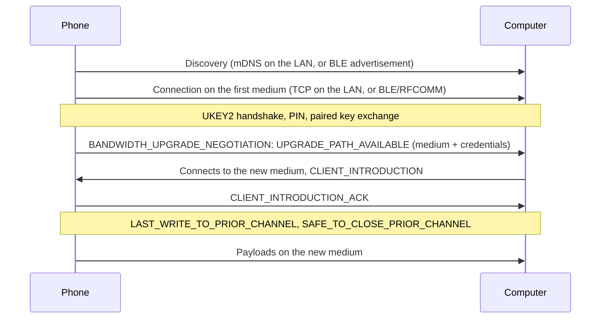

# Wi-Fi Direct: feasibility study

Research notes,

## Summary

| Question | Answer |
|---|---|
| What would it add? | Transfers with no shared Wi-Fi network, and faster transfers than Bluetooth when the phone is not on the LAN. Today both devices must be on the same network. |
| Is it possible on Linux? | Yes. Three open-source projects already do it (see [Prior art](#prior-art)). |
| Is it small? | No. It needs a Bluetooth LE entry point, the Nearby bandwidth-upgrade exchange, a Wi-Fi Direct group or hotspot driven through NetworkManager/wpa_supplicant, and privileges. |
| Does it work everywhere? | No. It depends on the Wi-Fi chip and driver, the regulatory domain and the phone's firmware. |
| Can it be tested here? | Not in Podman. It needs a real Wi-Fi card and a phone. |

Recommendation: do not start it as part of the shell. If pursued, begin with the [prototype](#suggested-first-step) and contribute the protocol work to `rqs_lib`.

## How Quick Share moves data

The Nearby Connections layer starts on a cheap medium and switches to a faster one:

The wire format already exists in `rqs_lib`: `offline_wire_formats.proto` defines `BandwidthUpgradeNegotiationFrame` with the event types above and the mediums `WIFI_LAN`, `WIFI_HOTSPOT`, `WIFI_DIRECT`, `BLUETOOTH`, `BLE`, `WIFI_AWARE`, `WEB_RTC`.

### Where KuickShare stands

| Piece | State in the pinned `rqs_lib` (`c9ac93f`) |
|---|---|
| mDNS discovery and TCP on the LAN | Working; the only path KuickShare uses and tests |
| Bandwidth-upgrade messages | Defined in the proto; the outbound handler advertises only `WIFI_LAN` (`hdl/outbound.rs`) |
| BLE | `hdl/ble.rs`, `hdl/blea.rs` (BlueZ through `bluer`) behind the `experimental` feature, which `Cargo.toml` enables. Whether it works with current phones has not been checked here *(unverified)* |
| Wi-Fi Direct, hotspot, Bluetooth Classic | Not implemented |

## What an implementation needs

| Layer | Work |
|---|---|
| Entry point | The phone must find the computer when it is not on the LAN: BLE advertisement and a GATT/L2CAP or RFCOMM channel (BlueZ). Some phones turn Wi-Fi off while choosing a target, so they find the computer only over BLE. |
| Protocol | Handle `UPGRADE_PATH_AVAILABLE` / `UPGRADE_PATH_REQUEST` for `WIFI_DIRECT` and `WIFI_HOTSPOT`, `CLIENT_INTRODUCTION`, the last-write and safe-to-close hand-over, and fall back to the first medium on `UPGRADE_FAILURE`. Receiving and sending are different code paths. |
| Wi-Fi link | Receiving: create a P2P group (or hotspot) and send its SSID, password, port and frequency to the phone. Sending: join the group the phone offers. Both through NetworkManager D-Bus or `nmcli`, on top of wpa_supplicant. |
| Privileges | Creating a group needs more than a normal user can do. Existing projects ship two small root helpers started through systemd and a polkit rule. |
| Packaging | The Flatpak sandbox has no access to `org.freedesktop.NetworkManager` or the system bus services it would need; the BlueZ talk-name is already granted. The AppImage and tarball can use the host's. |
| UI and settings | A "no network" mode, status of the link, a hint about unsupported hardware, firewall port for the hotspot case. |

## Prior art

| Project | What it is | Relevant for |
|---|---|---|
| [google/nearby](https://github.com/google/nearby) | Google's open-source Nearby Connections (C++, Apache-2.0) | The reference for frame order, timeouts and medium credentials; read it before writing code |
| [nozwock/rquickshare](https://github.com/nozwock/rquickshare) / [Martichou/rquickshare](https://github.com/Martichou/rquickshare) | The `rqs_lib` we depend on (Rust, GPL-3.0) | Base for any protocol work; upstream has no Wi-Fi Direct |
| [mtch3n/quickshare](https://github.com/mtch3n/quickshare) | Maintained fork of rquickshare | Its status table lists BLE wake-up as working, receive over BLE then Wi-Fi LAN as experimental, and Wi-Fi Direct, hotspot and WebRTC as unsupported. Notes: BlueZ `Experimental = true` lets BlueZ listen passively without disturbing other Bluetooth devices |
| [ignotusbucius/open-quickshare](https://github.com/ignotusbucius/open-quickshare) | Fork with BLE, Wi-Fi LAN and Wi-Fi Direct (Rust core, Tauri UI, GPL-3.0) | Uses NetworkManager through `nmcli` to host or join groups and hotspots; BLE for discovery, handshake and PIN, with L2CAP and fallback to BLE. Tested on a Pixel 9 Pro and Quick Share for Windows *(per its README)*. Limits: only "Everyone" visibility, the PC can briefly lose its Wi-Fi when hosting a hotspot on a single radio |
| [papshmeare/quickshare-direct](https://github.com/papshmeare/quickshare-direct), [DeveloperMatt02/DirectDrop](https://github.com/DeveloperMatt02/DirectDrop) | Fork focused on Wi-Fi Direct (Rust, GPL-3.0) | The most detailed account of the Linux side: a P2P group next to the normal Wi-Fi connection, two systemd root helpers (`quickshare-ap@USER` to create the link, `quickshare-join@USER` to join the phone's group), a polkit rule per user, a NetworkManager drop-in that keeps NM off the temporary interfaces, `QS_SINGLE_CHANNEL` for chips that cannot use a second channel. Reported about 5 MB/s receiving with the phone off Wi-Fi and about 36 MB/s sending to the phone's group *(self-reported)* |
| [kyujin-cho/Bada](https://github.com/kyujin-cho/Bada) | Another Quick Share client | [Issue #256](https://github.com/kyujin-cho/Bada/issues/256) documents a trap: for a send that starts over Bluetooth RFCOMM, the sender must itself request the upgrade, otherwise the transfer stays at about 140 KB/s. The receiver does not offer one on its own |

These projects are GPL-3.0 like KuickShare, so code can be reused with attribution, but they track upstream rquickshare, not the `nozwock` revision KuickShare pins. Porting means re-applying their changes to `rqs_lib`.

## Limitations and risks

| Limit | Detail |
|---|---|
| Hardware | The Wi-Fi card must run a second interface next to the normal connection, or the PC drops off its network for the transfer. Projects report most Intel, MediaTek and Qualcomm cards can *(unverified here)*. DFS channels and the default world regulatory domain block 5 GHz group owners (`iw reg set XX`). |
| Wi-Fi stack | wpa_supplicant as NetworkManager backend; `iwd` is reported as unsupported *(quickshare-direct README)*. NetworkManager's own P2P support only works on top of an existing non-P2P Wi-Fi interface (standalone P2P interfaces are not supported). I could not confirm which `nmcli` calls cover group-owner creation; the existing projects use `nmcli` and helper services. |
| Privileges | Root helpers and a polkit rule, or a capability-based design that has to be invented. Older polkit (Ubuntu 22.04) cannot start the helpers. |
| Phone side | Behaviour differs between Pixel (GmsCore) and Samsung; the phone's Wi-Fi radio should be on. Only "Everyone" visibility works, because "Contacts" and "Your devices" need Google-account certificates. |
| BLE | Background BLE discovery has been reported to interfere with bonded LE mice and keyboards ([rquickshare #429](https://github.com/Martichou/rquickshare/issues/429)). A BLE-only transfer is very slow and large files are refused. |
| Verification | Cannot run in CI or Podman. Every change needs a manual matrix: chip × phone × direction × with/without shared LAN. |
| Maintenance | The Nearby protocol has no stable public spec; phones change with Play Services updates. |
| Security | A temporary access point and root helpers enlarge the attack surface. The hotspot case opens a firewall port. The [threat model](architecture.md#threat-model) would need a section for it. |

## Suggested first step

A throw-away prototype, outside the app, on a real machine:

1. With `nmcli` and `iw`, check that the Wi-Fi card can host a P2P group while staying connected (`iw list` shows the supported interface combinations).
2. Reproduce what `open-quickshare` does for receiving from a phone with its Wi-Fi off, and note which chip and phone work.
3. Only if that works, add to `rqs_lib` (a fork) the BLE entry point and the upgrade handling, behind a setting that is off by default.
4. Design privileges last (systemd helpers vs. something else), because the Flatpak and AppImage differ.

## Sources

- [google/nearby](https://github.com/google/nearby) and the Nearby Connections [overview](https://developers.google.com/nearby/connections/overview)
- The projects in the table above (READMEs and issues)
- NetworkManager [`NMDeviceWifiP2P`](https://networkmanager.dev/docs/libnm/1.46/NMDeviceWifiP2P.html) and the wpa_supplicant P2P README
- Android [Wi-Fi Direct](https://developer.android.com/develop/connectivity/wifi/wifi-direct) for the group-owner model
