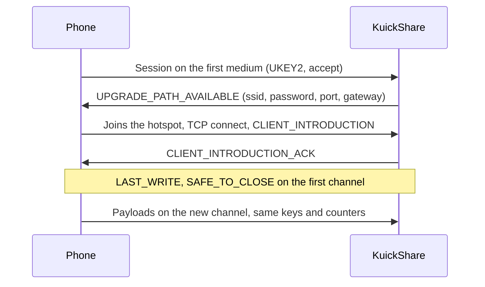

# Wi-Fi upgrade (transfers without a shared network)

> [!WARNING]
> Experimental and off by default (`WifiUpgrade`, Settings → Wi-Fi hotspot). Verified on real hardware (MT7922, Pixel 7 with Wi-Fi off), in both directions, over Bluetooth then Wi-Fi: receiving from the phone (we host a NetworkManager hotspot) and sending to it (the phone hosts a Wi-Fi Direct group that we join as a normal WPA2 client; a 328 MB file arrived intact at about 55 MB/s). Receiving from a Galaxy A55 (Samsung Quick Share, Android 16) also works: the phone sends over BLE GATT, joins our hotspot on 5 GHz and a file of about 329 MB took about 16 s on the hotspot (about 20 MB/s; the file was not compared after the transfer). Sending to the Galaxy also works: BLE GATT first, then the Wi-Fi Direct group the Galaxy offers (a 329 MB video took about 5 s on the Wi-Fi leg, about 65 MB/s from the log timestamps, and arrived with the same SHA-256 as the original), see [Sending over GATT](#sending-over-gatt). Not verified: see [Limits and unverified](#limits-and-unverified).

## What it does

Quick Share starts on a cheap medium and can switch to a faster one (the *bandwidth upgrade*). With the setting on, a phone with Wi-Fi off and the computer find each other over Bluetooth Low Energy (BLE), start the transfer there and move it to a Wi-Fi link:

| Direction | Hotspot host | KuickShare does |
|---|---|---|
| Receiving from a phone | KuickShare | Starts an access point (NetworkManager serves DHCP), offers the credentials, the phone joins and the transfer continues there |
| Sending to a phone | The phone | Scans for the phone, connects over BLE L2CAP, joins the Wi-Fi Direct group (or hotspot) the phone offers as a normal WPA2 client, connects to it and continues there |

If any step fails the transfer stays on the first channel, as it would without the setting.

## Layout

| Part | Where |
|---|---|
| Protocol: frames, hand-over state machine, timeouts, `WifiLink` trait | `third_party/rqs_lib/src/upgrade.rs`, handlers in `hdl/inbound.rs` and `hdl/outbound.rs` (see [THIRD_PARTY.md](../THIRD_PARTY.md)) |
| BLE receiver: `0xFEF3` advertisement, GATT "weave" service, bridge to a normal receive session | `third_party/rqs_lib/src/hdl/ble_receiver/` |
| BLE sender: windowed scan, L2CAP and GATT dial, central bridges | `third_party/rqs_lib/src/hdl/ble_scan.rs`, `hdl/ble_send/` |
| Bluetooth devices in the app: `ble:` ids, `ScanBluetooth`, job with its steps, Send page cleanup | `src/core/app.rs`, `src/core/dbus.rs`, `src/shell/` (see [D-Bus API](dbus-api.md)) |
| NetworkManager backend (`NmLink`): hotspot and join over D-Bus | `src/core/link.rs` |
| Setting | `wifi_upgrade` in `settings.json`, D-Bus property `WifiUpgrade` |

## Requirements and limits

| Item | Detail |
|---|---|
| Network stack | NetworkManager with a Wi-Fi card that can run an access point |
| Medium | Receiving: `WIFI_HOTSPOT` (we host). Sending: `WIFI_DIRECT` or `WIFI_HOTSPOT` as the phone offers (it hosts, we join). A P2P group on our side is not used, see [below](#why-not-a-p2p-group) |
| Privileges | None. The hotspot profile uses the `shared` IPv4 method, so NetworkManager starts its own `dnsmasq` for DHCP; the `dnsmasq` package must be installed on the host (without it the hotspot fails to start; the log then names it as a possible cause) |
| Firewall | While the hotspot is up, the upgrade port (TCP, random per transfer) is opened in firewalld's `nm-shared` zone through its D-Bus API and closed when the transfer ends (it also expires after 300 s). The hotspot profile is put in that zone, which otherwise allows only DHCP, DNS, ssh and ICMP. If firewalld cannot be changed (not running, or polkit refuses `org.fedoraproject.FirewallD1.zone`: Fedora allows `wheel` users, other distributions ask for a password) the profile goes to the `trusted` zone instead and the log says so, which lets the phone reach every service of the computer. Other firewalls (ufw, plain nftables) are not handled: they cannot be changed without root, so with them the zone is always `trusted`. Turning the setting on when firewalld is not running asks for confirmation first (`FirewallManaged` over D-Bus; *not tested* with ufw or nftables, nor inside Flatpak or the AppImage, where the check relies on the permission to talk to firewalld's name) |
| Wi-Fi on the host | With one radio the normal Wi-Fi connection may drop while the hotspot is up; the previous connection is re-activated when the transfer ends normally, but not after a crash (NetworkManager then reconnects by itself). With the setting on, the daemon deletes every NetworkManager profile whose name starts with `kuickshare-` at start and stop |
| Discovery | Over the LAN as usual. For a phone that is not on it, the BLE receiver advertises the computer while the setting is on and the device is visible. This makes the computer, under its device name, visible over Bluetooth to anything in range. It sends no data without the user's consent |
| Network loss | When NetworkManager reports that the last connection is gone, the devices found over the LAN are dropped at once (otherwise they stay until their mDNS records expire) and one Bluetooth scan runs. With another connection still up (Ethernet) nothing happens. When a network comes back, the discovery is restarted (the list is kept), because the mDNS library only checks for new interfaces every 30 s. Both are *not tested with a phone*; the Wi-Fi that KuickShare itself brings up for a receive also triggers the restart, which is harmless |
| LAN sessions | A transfer over the LAN never takes part in the upgrade: the sender announces `WIFI_LAN` as it did before the feature, and a receiver does not host a hotspot for a LAN peer. Only Bluetooth sessions upgrade. A phone seen both on the LAN and over Bluetooth is listed once, on the LAN |
| BLE speed | About 5 KB/s, so a transfer over BLE is only useful if the hotspot upgrade succeeds. A phone on the same LAN refuses a hotspot upgrade (Nearby's own rule), so the upgrade only applies off-LAN |
| Sending | To a phone in Receive mode (visibility Everyone), found by a short BLE scan (the Send page and its refresh button). The phone must show the Quick Share Receive screen, otherwise it advertises nothing usable (see Receive screen). A phone that advertises no PSM is sent to over GATT ([below](#sending-over-gatt)); a send that fails is reported at once, with a notification that says what to check. Samsung's Quick Share ends its advertisement after the token, with no mask byte (so no PSM): the parser accepts that. The Galaxy A55 appeared in scans only while the daemon was advertising itself *(observed twice, cause not verified)*. The phone hosts the network and we join it through NetworkManager. The sender announces `WIFI_HOTSPOT` and `WIFI_DIRECT`; the Pixel offered `WIFI_DIRECT` by itself. After the upgrade the phone uses frames without encryption (`supports_disabling_encryption`), which we follow. The sender holds the files for up to 10 s waiting for the offer |
| Trusted devices | Not available over Bluetooth: trust is keyed on the sender's MAC address read from its IP, which a BLE session does not have, and the phone's MAC on the Wi-Fi link is not the LAN one *(inferred)*. Every Bluetooth transfer asks for consent; the trust button is hidden and pairing is refused |
| Receive screen | The phone must show Quick Share's Receive screen. Seen on a Pixel 7 (Android 17, Play services 26.40.32) in the phone's `NearbySharing` log: `FOREGROUND` (Receive open) advertises `allowGattConnections=true` and `allowBleL2capConnections=true`; `BACKGROUND` (home screen, screen on) and `SCREEN_OFF` advertise both as `false`, even with visibility "Everyone" set permanently. This looks like how Quick Share works rather than a Pixel quirk; only the Pixel and the Galaxy A55 were observed |
| Flatpak | The manifest grants `--system-talk-name=org.freedesktop.NetworkManager` and `--system-talk-name=org.fedoraproject.FirewallD1`, and NetworkManager does the privileged work on the host, so only `dnsmasq` on the host is needed. Sending over Bluetooth also needs `--allow=bluetooth` (the L2CAP socket). Receiving from a phone was verified in the sandbox. A send started a few seconds after the list was filled once stayed at "Looking for the device…" (the rescan found nothing); the suspected cause is a rescan that started before BlueZ had stopped the previous discovery, now waited for in `ble_scan.rs` |
| Bluetooth controller | The MT7922 used for testing has known weird behaviours. It reset itself once during a scan (`LE Set Extended Scan Enable` timeout, USB reset, firmware reload); the next attempt worked, and the cause was not investigated |
| Tests | The `medium` key, the `ble:` ids and the watchdog that reports a send that never started are tested without an adapter. A send through a real adapter has no automated test (it would need a fake BlueZ inside `rqs_lib`): only the `#[ignore]` hardware tests, run by hand, cover it |

## Why not a P2P group

Creating a real Wi-Fi Direct group owner through wpa_supplicant's D-Bus works at the driver level, but NetworkManager 1.56 adopts the new `p2p-<if>-N` supplicant interface and removes it about 80 ms later. Marking the interface or `p2p-dev-<if>` unmanaged did not prevent it. Reading `Group.SSID` on a destroyed group also crashes wpa_supplicant 2.11. The hotspot path avoids both.

Findings from the hand test (tested Wi-Fi chip: MT7922, tested phone: Pixel 7):

- A NetworkManager AP-mode hotspot is visible to the phone and accepts WPA2.
- A DHCP server of our own had to answer by unicast to the client's MAC: the phone never accepted broadcast offers. NetworkManager's `dnsmasq` (`ipv4.method=shared`) works with the Pixel in both directions, so our server was removed.
- Android drops a network it validated as having no internet when joined from Settings. Nearby joins programmatically; no drop was seen in the logged transfers.

## Limits and unverified

Everything here was tested only with a Pixel 7 and a Galaxy A55 (Samsung Quick Share) on one MT7922 adapter. No other phone is available, so these cannot be closed by the project:

- Other phones and Wi-Fi chips, a laptop that is using its radio, two phones at once, DFS and regulatory domains (channel 36 with fallback to 2.4 GHz). Whether other phones need the Receive screen like these two do, and whether `MIDGROUND` (seen once on the Pixel) ever advertises GATT without L2CAP.
- Receivers that do not offer a bandwidth upgrade by themselves (the Pixel and the Galaxy do): the sender would have to send `UPGRADE_PATH_REQUEST`. It is not implemented and cannot be tested without such a phone.
- Our own Wi-Fi Direct group owner is not implemented, see [above](#why-not-a-p2p-group); the hotspot is the supported way to receive.
- Firewalls other than firewalld on Fedora. With ufw or nftables the hotspot always uses the `trusted` zone, which opens every port to the phone, and their own rules may also block DHCP and DNS of the hotspot *(not tested)*. The case where polkit refuses the change on firewalld has not been tried.

Checked on a hand run of the local script `dist/test-wifi.sh` (not in git; Pixel 7 receive, Galaxy A55 send):

- **NAT:** while the hotspot is up NetworkManager adds `masquerade` for `192.168.49.0/24` leaving the subnet, and forward rules limited to `wlp4s0` and that subnet; they are gone afterwards and nothing is left behind. `net.ipv4.ip_forward` stays `0`, so nothing is actually routed to another network, which a transfer between the two devices does not need.
- **Plasma job:** the job's step texts ("Looking for the device…", "Connecting…", "Waiting for the other device to accept", "Sending files", "Receiving files") and its terminate/progress updates reach the tracker (`org.kde.JobViewV3` in the bus capture). The popup showed the title, the progress bar and the Cancel button for a receive; the other step texts were seen only in the capture, not on screen.
- **Kernel log:** no `btusb`/`mt79xx` reset or Wi-Fi timeout around the transfers. One `hci0: Opcode 0x202d failed: -16` ("Unable to disable LL privacy") appeared when BLE advertising started, a few seconds before a transfer; the controller was busy and the transfer was not affected.

Seen in logs, so not open: the plain frames after the upgrade, the phone's `CLIENT_INTRODUCTION` endpoint id (checked by the receiver before it continues) and an advertisement without the "RxInstantConnectionAdv" field all work on both phones (transfers completed, one compared by SHA-256).

Behaviour with a known cause or a harmless effect, from the logs of the Galaxy A55 send (UTC, timestamps from the daemon and `btmon`):

- **First join fails** with `the access point was not found`, about 2.5 s after the offer and before NetworkManager starts to activate; the second attempt associates about 1.5 s later and the transfer proceeds. The group is probably not in the scan results yet *(inferred: neither NetworkManager nor wpa_supplicant log scan results)*. The retry is the intended handling.
- **`GattDial: disconnect timed out`** is our 2 s timer. The Galaxy never closes the LE link; BlueZ sent the HCI disconnect 0.63 s after the timer and it completed with status 0. The Wi-Fi was already associated. No controller error or reset appears in `btmon`; the kernel log was not captured, so a coexistence problem is not excluded (it did not occur in a later run). The link does close and the transfer is unaffected.
- The ATT "Attribute Not Found" probes right after the GATT send, `Reject scan trigger since one is already pending` and the `mdns_sd` closed-channel errors when the daemon exits are benign. `mdns_sd` also logs `Network is unreachable` sending to 224.0.0.251 on the hotspot interface (no multicast route there, *inferred*); it has no visible effect.

Timings: the 40 s watchdog for a send that never started covers the observed time to the first frame (about 18 s over L2CAP and 22 s over GATT, most of it the 12 s scan); the join takes up to about 9 s and the phone gives up after about 15 s; the Pixel sends its full advertisement only about every 10 s, so a scan window shorter than that can miss it (the windows are 15 s for the list and 12 s for a send).

Known weaknesses without a reproducible cause: BLE re-advertising and `Device::disconnect` side effects; the GATT notify race (a rewrite with `CharacteristicNotifyMethod::Io` would bind the session to the subscriber); phones on the LAN were not rechecked after the BLE scanner was removed; a phone that cancels in the middle of a file is noticed only when a write makes no progress for 30 s (the user's own cancel works at once; a cancel frame sent by the phone is not read while we send).

For a phone-side capture use `adb logcat -s NearbyConnections NearbyMediums NearbySharing WifiP2pService` (offered medium, `supports_disabling_encryption`, join latency, invalid frames, `allowBleL2capConnections`) together with the daemon log and `btmon -w`, also with a phone on another network and on the same LAN (a phone on the same LAN refuses a hotspot upgrade).

## Testing

`cargo test -p rqs_lib` runs the hand-over, plain and encrypted, the Bluetooth receiver and sender and the scanner in memory and over loopback with a fake `WifiLink`. `cargo test --all-features` covers `link.rs` with a fake NetworkManager. Neither needs hardware. The real link needs a manual test (Wi-Fi card, Bluetooth adapter, phone, `adb logcat` and `btmon` captures): the procedure is in [CONTRIBUTING.md](../CONTRIBUTING.md#hand-tests-with-a-phone-wi-fi-upgrade-and-bluetooth).

## Sending over GATT

A phone that advertises no PSM (the Galaxy A55 with Samsung Quick Share) is sent to as the GATT central of the Nearby "BLE socket", with the same send session as over L2CAP. `find_target` keeps scanning until the end of its window for a PSM and falls back to the sighting without one; `BleScanner::send` then picks `dial_l2cap` or `dial_gatt`. GATT only carries the handshake and the upgrade offer, so its speed (a few KB/s) does not matter.

| Part | Where |
|---|---|
| Central side of weave (connection request, confirm, framing) | `ble_send/weave_central.rs`, reusing `Packetizer`/`Reassembler` of `ble_receiver/weave.rs` |
| Bridge between the GATT channels and the session stream | `ble_send/gatt_bridge.rs` (`GattCentralBridge`, `GattLink`); `send_over_gatt` in `ble_send/mod.rs` shares the session driving with `send_over_l2cap` |
| BlueZ dial: connect, find the service holding the Nearby characteristics, subscribe, write | `ble_send/gatt_dial.rs` (`dial_gatt`) |

The phone's table (Galaxy A55): two 0xFEF3 services, one with the five slot characteristics and one with `…1a11000101` (flags `write`, with response) and `…1a11000102` (flags `indicate`); ATT MTU 517, so packets of 509 bytes. It connects without pairing. `dial_gatt` picks the service that holds both Nearby characteristics, writes one packet at a time and subscribes with `StartNotify`, which also covers indications.

| Verified | How |
|---|---|
| Whole send session over GATT, with the upgrade, against our own receiver | In-memory loopback tests (`ble_send/gatt_tests.rs`), including 20-byte packets |
| Dial and weave handshake, and a complete 8 KB send, on a real phone | Pixel 7 in Receive mode, forced onto GATT with `KS_TRANSPORT=gatt` in `send_small_file_to_phone`: link up in about 5 s, MTU 512, transfer finished. After the end the phone sends a weave error packet; the bridge reports it as `Protocol`, which does not fail the transfer |
| Whole send to the Galaxy A55 (Samsung Quick Share, Android 16) | GATT link up in 1.7 s, MTU 512, then `receiver offers WifiDirect` (5765 MHz); the first join attempt failed (`the access point was not found`), the second worked, and the join took about 5 s after the offer. The 329 MB video arrived with the same SHA-256 as the original (checked with `sha256sum` on the phone through `adb`) |

> [!NOTE]
> The Galaxy's `nearby_connections` advertiser ran only in short bursts in some runs (37 s and 3 s in its `dumpsys bluetooth_manager`) and reopening the Receive screen did not restart it, so the scanner did not see it then; the cause is unknown. Not verified: whether the Galaxy sends its own socket introduction (the code tolerates both).

## References

| Project | Use here |
|---|---|
| [google/nearby](https://github.com/google/nearby) | Reference for frame order, timeouts and credentials (`bwu_manager.cc`) |
| [quickshare-direct](https://github.com/papshmeare/quickshare-direct) | Linux implementation of both directions, tested on a Pixel; source of the timing notes |
| [open-quickshare](https://github.com/ignotusbucius/open-quickshare) | Same idea over `nmcli`; client join and role switch |
| [Bada #256](https://github.com/kyujin-cho/Bada/issues/256) | For a send that starts on a slow medium the sender may have to request the upgrade itself *(not implemented)* |
